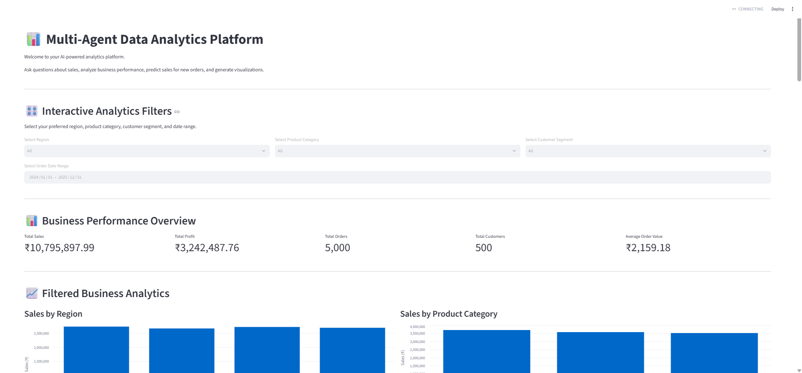
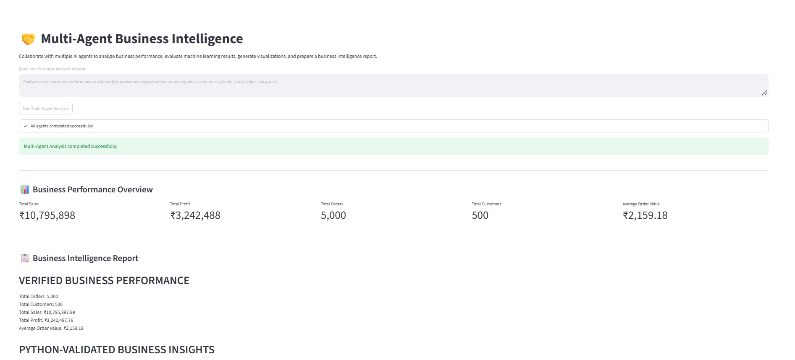

# 🤖 Multi-Agent Data Analytics & Insights Platform

An AI-powered Business Intelligence platform combining **Data Analytics, Machine Learning, Data Visualization, and Multi-Agent AI Systems** to analyze business performance and generate actionable insights.

Built using Python, Streamlit, LangGraph, LangChain, and Ollama.

---

## 📌 Project Overview

This project demonstrates how multiple specialized AI agents collaborate to analyze business data, evaluate machine learning results, generate visualizations, and prepare comprehensive business intelligence reports.

The platform uses a supervisor-based architecture and a collaborative multi-agent workflow to process user queries and deliver analytical insights.

It also integrates locally running Large Language Models (LLMs) to generate natural-language explanations of Python-validated findings.

---

## 🚀 Key Features

### 1. Interactive Business Intelligence Dashboard
- Total Sales and Total Profit tracking.
- Total Orders and Unique Customers.
- Average Order Value (AOV).
- Dynamic filters for region, product category, customer segment, and date.
- Interactive business performance visualizations.
- Dynamic monthly sales trend analysis.

### 2. Data Analyst Agent
- Sales performance analysis.
- Regional sales comparison.
- Product category analysis.
- Customer segment analysis.
- Monthly sales trends.
- Top-performing products.

### 3. Machine Learning Agent
- Random Forest Regression model.
- Sales prediction based on quantity, unit price, and discount.
- Model performance evaluation using MAE and R².
- Feature importance analysis.

### 4. Visualization Agent
- Sales by Region.
- Sales by Product Category.
- Profit by Region.
- Sales by Customer Segment.
- Monthly Sales Trends.

### 5. Supervisor Agent
- Understands user analytical queries.
- Routes requests to the appropriate specialized agent.
- Coordinates Data Analyst, ML Analyst, and Visualization agents.

### 6. Multi-Agent Collaboration

A LangGraph-powered workflow where multiple agents collaborate sequentially:

- Data Analyst Agent
- ML Analyst Agent
- Visualization Agent
- LLM Reporting Agent

The workflow combines analytical results, machine learning outputs, and visualizations into a consolidated business intelligence report.

### 7. LLM-Powered Business Explanation
- Integrates local Ollama models.
- Generates natural-language explanations.
- Uses Python-calculated findings as the source of truth.
- Produces business recommendations based on verified analytics.

---

## 🏗️ System Architecture

```text
                         USER
                           |
                           v
                    STREAMLIT APP
                           |
              +------------+------------+
              |                         |
              v                         v
       SUPERVISOR AGENT          COLLABORATION WORKFLOW
              |                         |
       +------+------+           +------+------+
       |      |      |           |      |      |
       v      v      v           v      v      v
      DATA    ML   VISUAL       DATA    ML   VISUAL
    ANALYST ANALYST AGENT     ANALYST ANALYST AGENT
       |      |      |           |      |      |
       +------+------+           +------+------+
              |                         |
              v                         v
       ANALYTICAL RESULTS           LLM REPORT
                                         |
                                         v
                               BUSINESS INSIGHTS
                               & RECOMMENDATIONS
```

---

## 🛠️ Technology Stack

| Category | Technologies |
|---|---|
| Programming Language | Python 3.11 |
| Data Analysis | Pandas, NumPy |
| Machine Learning | Scikit-learn, XGBoost |
| AI Frameworks | LangChain, LangGraph |
| Local LLM | Ollama |
| LLM Models | Llama 3.2, Qwen 3 |
| Dashboard | Streamlit |
| Data Visualization | Matplotlib |
| Database Toolkit | SQLAlchemy |
| Development Environment | VS Code |

---

## 📂 Project Structure

```text
Multi_Agent_Data_Analytics_Platform/
│
├── agents/
│   ├── data_analyst_agent.py
│   ├── ml_analyst_agent.py
│   ├── visualization_agent.py
│   ├── supervisor_agent.py
│   ├── supervisor_llm.py
│   ├── llm_agent.py
│   └── collaboration_agent.py
│
├── data/
│   └── sales_data.csv
│
├── screenshots/
│   ├── dashboard.png
│   └── multi_agent_analysis.png
│
├── app.py
├── generate_data.py
├── requirements.txt
├── README.md
├── .gitignore
│
└── Generated Visualization Images
```

---

## 📊 Dataset Information

The application uses a synthetic sales dataset containing:

- **5,000 records**
- **500 unique customers**
- **12 columns**
- Sales data covering January 2024 to December 2025.

### Dataset Attributes

| Column | Description |
|---|---|
| order_id | Unique order identifier |
| order_date | Date of order |
| customer_id | Customer identifier |
| customer_segment | Customer classification |
| region | Sales region |
| product_category | Product category |
| product | Product name |
| quantity | Units purchased |
| unit_price | Price per unit |
| discount | Applied discount |
| sales | Total sales amount |
| profit | Profit generated |

---

## 🤖 Machine Learning Details

The Machine Learning Agent uses a Random Forest Regressor.

### Input Features
- Quantity
- Unit Price
- Discount

### Model Outputs
- Predicted Sales
- Mean Absolute Error (MAE)
- R² Score
- Feature Importance

**Note:** The dataset is synthetic. The strong model performance reflects the structure of this generated dataset and should not be interpreted as proven real-world forecasting accuracy.

---

## ⚙️ Installation & Setup

### Prerequisites

- Python 3.11
- Git
- Ollama
- VS Code (recommended)

### Step 1: Clone the Repository

```bash
git clone https://github.com/bhaktegaurav1999-hub/Multi_Agent_Data_Analytics_Platform.git
```

```bash
cd Multi_Agent_Data_Analytics_Platform
```

### Step 2: Create a Virtual Environment

```bash
python -m venv venv
```

### Step 3: Activate the Environment

Windows PowerShell:

```powershell
.\venv\Scripts\Activate.ps1
```

### Step 4: Install Dependencies

```bash
pip install -r requirements.txt
```

### Step 5: Install Ollama Models

Download and install Ollama:

https://ollama.com/

Pull the required models:

```bash
ollama pull llama3.2:3b
```

```bash
ollama pull qwen3:4b
```

Ensure the Ollama service is running before using the LLM-powered features.

### Step 6: Run the Application

```bash
streamlit run app.py
```

The application will open in your browser at the local Streamlit address displayed in the terminal.

---

## 📸 Application Screenshots

### 1. Business Intelligence Dashboard



### 2. Multi-Agent Business Intelligence



---

## 🔮 Future Enhancements

- Integration with real-world business datasets.
- Advanced sales forecasting.
- Additional specialized AI agents.
- Database integration and persistent storage.
- Advanced model evaluation and monitoring.
- Cloud deployment.
- Enhanced business intelligence reporting.

---

## 👨‍💻 Author

**Gaurav Bhakte**

Data Analytics | Python | Machine Learning | Generative AI | Multi-Agent AI Systems

GitHub: https://github.com/bhaktegaurav1999-hub

---

⭐ If you find this project interesting, consider giving it a star!